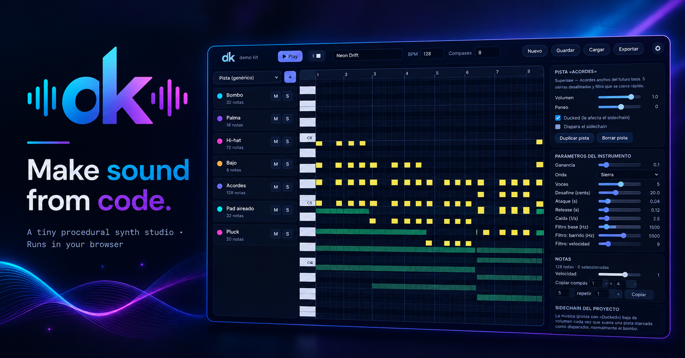

<div align="center">



# Demo Kit

**Make sound from code.**
Un pequeño estudio de síntesis procedural que corre en el navegador: piano roll, capas, instrumentos parametrizables y plugins, todo sobre `demo_kit.js`.

### 🎹 [Abrir Demo Kit en el navegador](https://mialmoga.github.io/demo-kit/)

</div>

---

## Qué es

Demo Kit es un DAW de juguete (pero poderoso) contenido en **un solo archivo HTML**, sin dependencias, sin servidor, sin archivos de audio. Todo el sonido se calcula muestra a muestra en JavaScript con el kit de síntesis `demo_kit.js` (que va incrustado), el mismo que genera las demos *The Void* y *Cotton Sugar*.

Se pueden componer piezas desde cero, o **cargar una demo y convertirla en un proyecto editable** (pistas, notas y parámetros) para ver cómo está construida.

## Uso rápido

1. Abre la versión en línea: **<https://mialmoga.github.io/demo-kit/>**. O descarga `demo_kit_studio.html` y ábrelo con doble clic (no necesita servidor; el favicon y las imágenes vienen de `favicon.ico` y `assets/`, así que sin ellos el HTML funciona igual pero sin iconos).
2. «Demos y plugins» → «Cargar proyecto de ejemplo», y dale **Play**.
3. O arrastra algún demo de la carpeta demos/ a la ventana y pulsa **«✎ Convertir en editable»**.

| Archivo | Demo | Función |
|---|---|---|
| `electronic_rush.js` | ⚡ Electronic Rush - Ws | `no editable`|
| `the_void_MK.js` | 🕳️ The Void - Ws | `no editable` |
| `cotton_sugar_MK.js` | 🍬 Cotton Sugar - Ws | `no editable` |
|---|---|---|
| `event_horizon.js` | 🌑 Event Horizon - Ws | `renderVoidV2` |
| `marshmallow_sky.js` | ☁️ Marshmallow Sky - Ws | `renderCottonV2` |
| `dark_matter.js` | 🌌 Dark Matter - Ws | `renderDarkMatter` |
|---|---|---|
| `the_void.js` | 🕳️ The Void (edit) | `renderVoid` |
| `cotton_sugar.js` | 🍬 Cotton Sugar (edit) | `renderCotton` |
|---|---|---|
| `yo_soy_nan.js` | ♾️ You Soy NaN (by Éter) | `renderYoSoyNaN` |

> las marcadas como no editables se pueden reproducir y exportar a .WAV usan un kit diferente que viene incrustado.
> Todas las marcadas - Ws forman parte del proyecto Wavesurfer  **<https://mialmoga.github.io/Wavesurfer/>**

> El audio solo se genera cuando pulsas Play o WAV: Demo Kit renderiza el proyecto completo y luego lo reproduce. Si cambias algo, el indicador de arriba a la derecha muestra «cambios sin renderizar» y el siguiente Play vuelve a renderizar.

## Funciones

- **Piano roll** con rejilla (1/4 a 1/32, tresillos o libre), zoom, notas fantasma de las otras pistas, selección múltiple, velocidad por nota y deshacer.
- **Pistas / capas ilimitadas**, cada una con su instrumento, volumen, paneo, mute y solo.
- **Instrumentos base parametrizables** (cada uno con sus sliders):
  - *Melódicos:* Sinte genérico, Supersaw, Pluck, Arpegio cuadrado, Pad, Sub, Sub con caída, Reese, Growl, Campana, Chop vocal.
  - *Percusión y efectos:* Bombo, Caja, Palma, Chasquido, Hi-hat (cerrado/abierto), Crash, Riser, Barrido, Viento, Impacto, Rim.
- **Sidechain:** las pistas «ducked» (la música) bajan de volumen cada vez que suena una pista marcada como disparador (normalmente el bombo). Profundidad y relajación ajustables.
- **Efectos por pista:** *delay* (tiempo en negras/corcheas, repeticiones, tono, mezcla, ping-pong) y *reverb* (tamaño, amortiguación, mezcla, pre-delay). Se aplican sobre el audio ya renderizado de la pista, así que moverlos **no vuelve a renderizar el instrumento**. También suenan al tocar en vivo y en la vista previa.
- **Automatización por pista:** botón «📈 Automatización» bajo el piano roll. Curvas de **volumen**, **paneo** y **filtro** (pasa-bajos de 80 Hz a 18 kHz) con puntos en pulsos: clic = punto, arrastrar = mover (respeta la rejilla), doble clic o clic derecho = quitar, `Ctrl+Z` deshace. Se aplican al mezclar, después de los efectos, así que editarlas no vuelve a renderizar el instrumento. Se oyen al dar Play, en el WAV y en los stems; no al tocar en vivo.
- **Escalas y acordes:** elige tónica y escala (mayor, menor natural/armónica, pentatónicas, dórica, frigia, mixolidia, blues): el piano roll resalta las notas de la escala y la tónica. «Ajustar» mueve a la escala lo que dibujas. El selector **Acorde** (tríada, séptima, quinta, sus4, octava) hace que cada clic en el roll, cada tecla o cada nota MIDI suene y escriba el acorde completo, apilado sobre los grados de la escala si hay una elegida. La escala se guarda con el proyecto.
- **Teclado en pantalla** (🎹 Teclado): dos octavas para tocar con el ratón o el dedo, con los mismos acordes, grabación y efectos que el teclado de la compu. En pistas de percusión muestra un pad por carril.
- **Edición de notas:** transponer (±1, ±12), cuantizar inicios y largos a la rejilla, forzar a la escala, y copiar/pegar notas entre pistas (`Ctrl+C` / `Ctrl+V`, se pega en el cursor). Actúan sobre la selección, o sobre toda la pista si no hay. Todo se deshace con `Ctrl+Z`.
- **Carril de velocidad:** en el mismo carril de la automatización, «Velocidad de notas» muestra una barra por nota; arrástrala para cambiarla (si la nota está seleccionada, cambia toda la selección; si no, las notas que empiezan en ese pulso).
- **Master:** graves y agudos (shelves de ±12 dB en 120 Hz y 7 kHz), ganancia y limitador con anticipación y techo ajustable. Con todo neutro el sonido original queda intacto.
- **Tocar en vivo** la pista activa con el teclado de la compu o con un controlador MIDI, para afinar parámetros escuchando (ver [abajo](#tocar-en-vivo)).
- **Grabar lo que tocas** en el piano roll, con cuenta previa, cuantizado, bucle con overdub y un solo `Ctrl+Z` por toma (ver [abajo](#grabar-lo-que-tocas)).
- **Plugins:** instrumentos nuevos escritos en JavaScript, con editor integrado.
- **Demos editables:** convierte las demos del kit en proyectos con pistas y notas.
- **Pantalla activa** mientras suena (Wake Lock, con un video invisible de respaldo en navegadores que no lo soportan).
- **Render por pista con caché:** cada pista se renderiza sola y se guarda. Editar una pista solo vuelve a renderizar esa pista, y cambiar volumen, mute o solo no renderiza nada. Un Play tras un cambio pequeño tarda una fracción de segundo.
- **Exportación a WAV** (estéreo, 16 bits, 44.1 kHz) y **a stems**: un ZIP con un WAV por pista (incluidas las silenciadas), con los efectos de cada pista pero sin el master, para seguir mezclando en otro DAW. No hay exportación MIDI a propósito: el kit suena mejor que cualquier sinte MIDI genérico.
- **Guardar / cargar** proyectos `.demokit.json`.
- **Guardar compacto** («⬇ Compacto»): el mismo `.demokit.json` pero para producción: notas en arreglos, sin los parámetros que son los de fábrica. El ejemplo del estudio baja de 13.7 KB a 6 KB (≈1.3 KB con gzip). Al descargarlo muestra un **reporte de peso** y avisa si los clips horneados o los plugins lo inflan. Las notas se guardan con 5 decimales de pulso (error menor a 0.01 ms); «Guardar» normal conserva todo tal cual.
- **Exportar como demo `.js`** («⬇ Demo .js»): una demo autónoma, con la forma `async function renderXxx(sr, onProg)` y `BPM`/`BARS` en el encabezado, que lleva dentro el proyecto editable y el motor del estudio. Suena **igual** que en el estudio (la diferencia medida contra el render del estudio fue 0, con efectos, automatización y master) y solo necesita `demoKit`, como cualquier demo: sirve para cargarla en un juego como WAVESURFER. Al cargarla de nuevo en el estudio, «Convertir en editable» recupera el proyecto **sin pérdidas** (incluye plugins usados, automatización, efectos, escala y clips). Pesa unos 50 KB (el motor va incrustado); si el proyecto tiene clips horneados (como The Void convertida) pesa mucho más (≈13 MB).

## Controles

| Acción | Cómo |
|---|---|
| Crear nota | clic en el piano roll |
| Alargar al crear | clic y arrastrar |
| Cambiar el largo | arrastrar el borde derecho de la nota |
| Mover | arrastrar la nota (también vertical para cambiar el tono) |
| Seleccionar varias | `Shift` + arrastrar un recuadro, o `Shift` + clic |
| Borrar | `Supr` / `Retroceso`, clic derecho sobre la nota, o modo «Borrar» |
| Duplicar selección | `Ctrl/⌘ + D` |
| Seleccionar todo | `Ctrl/⌘ + A` |
| Deshacer | `Ctrl/⌘ + Z` |
| Mover selección | flechas (`Shift`: 1 pulso / 1 octava) |
| Punto de inicio de reproducción | clic en la regla de compases (`Inicio` lo lleva a 0) |
| Play / Stop | `Espacio` |
| Zoom | botones ＋ / −, o `Ctrl` + rueda |
| Escuchar una tecla | clic en el teclado de la izquierda |

En pantallas táctiles hay un modo **✋ Navegar** para desplazarse con el dedo sin dibujar notas.

## Tocar en vivo

Con el botón **⌨ Tocar** activo, el teclado de la compu toca la pista seleccionada, como en FL Studio o Ableton. Mueve un slider del inspector, toca una tecla y escucha cómo cambia el sonido.

```
 2 3   5 6 7   9 0          fila de arriba:  octava de arriba (empieza en la octava +1)
Q W E R T Y U I O P

  S D   G H J   L ;         fila de abajo:   octava base (por defecto C4)
 Z X C V B N M , . /
```

- **Octava:** `−` / `=` (o los botones de la barra). La octava base se muestra junto al botón.
- **Percusión:** en pistas de un solo carril (bombo, caja…) cualquier tecla del mapa lo dispara. En pistas de varios carriles (hi-hat: cerrado/abierto), las teclas `Z X C V B N M` son los carriles 1, 2, 3…
- **MIDI:** pulsa **🎛 MIDI**, acepta el permiso del navegador y elige la entrada. Soporta velocidad, pedal de sustain (CC64) y «all notes off». En percusión, un teclado MIDI usa las notas a partir de C1 (36), una por carril. Web MIDI funciona en Chrome, Edge y Opera; Firefox lo pide como permiso y Safari no lo tiene. Necesita HTTPS (GitHub Pages lo cumple) o `localhost`.
- **Latencia:** cada nota se renderiza una vez y queda en caché; tocar es solo disparar un buffer ya listo. Al elegir una pista (o al soltar un slider) se precalientan en segundo plano las tres octavas del teclado. Una nota fuera de ese rango, o la primera tras cambiar un parámetro, tarda unos 10–50 ms en renderizarse.
- **Largo de las notas:** al tocar, cada nota dura como máximo ~2 s y, al soltar la tecla, tiene un fundido de salida de 90 ms. La percusión y los sonidos cortos suenan completos.
- Las teclas del modo **Tocar** no interfieren con los atajos de edición (todos usan `Ctrl`, flechas, `Supr`, `Espacio`…) y se desactivan solas mientras escribes en un campo de texto o hay una ventana abierta.

## Grabar lo que tocas

1. Elige la pista donde quieres grabar.
2. Pulsa **⏺ Grabar** (queda armado, en rojo). Es independiente de Play: puedes armarlo y desarmarlo cuando quieras.
3. Pulsa **Play** (o `Espacio`). Si «cuenta previa» está activo, hay un compás de metrónomo y la grabación empieza al terminar. El proyecto suena como acompañamiento desde el cursor (el punto de inicio que marcas en la regla).
4. Toca con el teclado de la compu o con MIDI. Las notas aparecen en el piano roll mientras las sostienes.
5. Pulsa Stop. Toda la toma se deshace con un solo `Ctrl+Z`.

Detalles:

- **Cuantizar** ajusta el inicio y el largo de cada nota a la **Rejilla** elegida. Con la rejilla en «libre» (o con cuantizar desactivado) se graba tal cual lo tocaste.
- **Bucle:** si está activo, el bucle cubre exactamente los compases del proyecto y cada vuelta suma notas encima (overdub). Tocar la misma nota en el mismo lugar no la duplica.
- **Punch-in:** si el proyecto ya está sonando y pulsas ⏺, empieza a grabar en ese momento. Si lo desarmas a la mitad, se cierra la toma.
- **Pedal de sustain** (MIDI): la nota grabada dura hasta que sueltas el pedal. La velocidad MIDI se guarda en cada nota.
- **Percusión:** las notas se graban en el carril correspondiente con largo fijo.
- Si cambias de pista durante la toma, las notas abiertas se cierran en su pista.
- Las notas grabadas no suenan en el acompañamiento hasta el siguiente render (Play vuelve a renderizar solo si hubo cambios). Mientras tocas, oyes tu instrumento en vivo, así que se siente igual.
- Si pasas del último compás, el proyecto se extiende solo (fuera de bucle).

## Convertir una demo en proyecto editable

Las demos del kit son funciones `async function renderXxx(sr, onProg)` que llaman a `K.kick`, `K.syn`, `K.bell`… directamente. Demo Kit las **ejecuta con un kit «grabador»**: cada llamada queda registrada (momento, parámetros, canal) en vez de sonar, y luego se agrupa en pistas con sus notas y parámetros más comunes. La curva de sidechain de la demo se guarda como tabla.

Resultado actual con las demos incluidas:

| Demo | Pistas | Notas |
|---|---|---|
| Cotton Sugar | 15 | 1928 |
| The Void | 17 | 1693 |
| Yo soy NaN | 11 | 322 |

Límites a tener en cuenta:

- **No es idéntica muestra por muestra.** Las fases iniciales de los osciladores y el ruido salen de un generador que cambia con el orden de las llamadas. La energía por segundo coincide (diferencia media de ~3 % en Cotton Sugar y ~1 % en The Void), pero no son bit a bit iguales.
- Los `add()` con funciones propias que no se pueden parametrizar (el sub del drop de The Void, por ejemplo) quedan como pista **«Clip»** con audio horneado. Funcionan, pero no son editables, y hacen que el proyecto guardado pese más (≈ 9 MB en The Void). Rehacer esa pista con un instrumento como «Sub con caída» la vuelve editable.
- Los ajustes que cambian nota por nota (un filtro que se abre a lo largo de una sección, por ejemplo) se conservan por nota y se marcan con un punto blanco; hay un botón para unificarlos con los controles de la pista.
- La conversión reconoce funciones auxiliares conocidas (`reese`, `growl`, `rim`, `wash`, `impact`) por su nombre. Una demo con helpers nuevos los trata como `add()` horneados.

## Escribir demos compatibles (para humanos e IAs)

Una demo es un archivo `.js` con una función `async` que usa `demoKit` y devuelve el audio. Si solo usa las funciones nombradas del kit, **se convierte en un proyecto completamente editable**. *Yo soy NaN* la escribió una IA (Éter) viendo el kit y un par de ejemplos, y convirtió a la primera.

**El contrato**

```js
// ── Título de la demo · lo que quieras ──      ← el texto antes del primer «·» es el nombre del proyecto
// BPM = 100 | BARS = 4                           ← BPM y BARS: el convertidor los busca con estos nombres en mayúsculas
async function renderLoQueSea(sr, onProg) {      // el nombre debe empezar con «render»
  const K = demoKit(sr, BARS*bar + 2.5, 20261015);   // segundos totales (+2.5 s de cola) y semilla
  // ... llamadas a K.kick, K.syn, K.bell, etc.
  return K.mix(duckAt);                          // duckAt(t) → ganancia de la música (1 = sin sidechain)
}
```

**Qué se convierte en notas editables**

| En la demo | En el estudio |
|---|---|
| `K.kick` `K.snare` `K.clap` `K.snap` `K.hat` `K.crash` | pistas de batería (el hi-hat abierto va en el segundo carril) |
| `K.syn(buf, …)` | pistas «Sinte» (se agrupan por onda, envolvente y desafine), con ganancia, voces, filtro y envolvente como sliders |
| `K.bell` `K.chop` `K.riser` `K.sweep` | sus instrumentos, con parámetros |
| funciones propias llamadas `reese` `growl` `rim` `wash` `impact` | sus instrumentos (se reconocen por el nombre) |
| `K.mix(duckAt)`, la función que quieras | una curva de sidechain guardada como tabla |

**Qué no se convierte, y cómo evitarlo**

- `K.add` con una función propia (osciladores o filtros escritos a mano) queda como pista **«Clip»**: suena igual, pero no es editable. Para que sea editable, expresa ese sonido con `K.syn` o escribe un [plugin](#plugins-instrumentos-propios).
- Un filtro que no sea un número ni la forma `t => base + barrido * Math.exp(-t * velocidad)` se conserva como función propia, en vez de sliders. El sonido es idéntico; solo ese parámetro no es ajustable con un slider.
- Si no hay `BPM = N` (mayúsculas) ni «N BPM» en el archivo, se asume 120. Si no hay `BARS = N`, los compases se deducen de la duración.
- Los demos corren en la página con `demoKit` y `sleep` disponibles. No hay archivos ni red.

**Un ejemplo mínimo** (convierte en 5 pistas y 72 notas):

```js
// ── Ejemplo mínimo · demo para Demo Kit ──
// /demos/ejemplo_minimo.js
// BPM = 100 | BARS = 4
async function renderEjemplo(sr, onProg) {
  const BPM = 100, BARS = 4, beat = 60 / BPM, bar = beat * 4;
  const K = demoKit(sr, BARS * bar + 2.5, 20261015);
  const kicks = [];
  for (let b = 0; b < BARS; b++) {
    const t0 = b * bar;
    for (let i = 0; i < 4; i++) { K.kick(t0 + i * beat, 0.9); kicks.push(t0 + i * beat); }
    K.clap(t0 + beat, 0.5); K.clap(t0 + 3 * beat, 0.5);
    for (let h = 0; h < 8; h++) K.hat(t0 + h * beat / 2, h % 2 ? 0.1 : 0.2, false, h % 2 ? 0.3 : -0.3);
    [57, 60, 64].forEach(m => K.syn(K.mu, t0, bar * 0.95, K.hz(m), 0.1, 0, { w: 0, atk: 0.2, rel: 0.3, det: [-8, 0, 8], lp: 1200 }));
    K.syn(K.mu, t0, beat * 0.9, K.hz(33), 0.4, 0, { w: 2, atk: 0.01, rel: 0.1, lp: 400 });
    if (onProg) onProg(b / BARS);
  }
  const duckAt = t => { let g = 1; for (const k of kicks) { const d = t - k; if (d >= 0 && d < 0.25) g = Math.min(g, 0.4 + 0.6 * (d / 0.25)); } return g; };
  return K.mix(duckAt);
}
```

**Pedirle una demo a una IA:** pásale `demo_kit.js`, este ejemplo (o `yo_soy_nan.js`) y algo como:

> Escribe una demo para Demo Kit en el estilo del ejemplo: una sola función `async function renderXxx(sr, onProg)`, con `BPM = N` y `BARS = N` en el encabezado, que use solo funciones de `demoKit` (`kick`, `snare`, `clap`, `hat`, `syn`, `bell`, `chop`, `riser`, `sweep`, `crash`) y termine con `return K.mix(duckAt)`. Sin `K.add` propios. Estilo: …

## Plugins (instrumentos propios)

«Demos y plugins» → «Escribir un plugin nuevo» abre un editor con una plantilla. Un plugin es un objeto que llama a `registerInstrument`:

```js
registerInstrument({
  name: 'Campana FM',
  kind: 'melodic',                 // 'melodic' = piano roll · 'perc' = carriles
  params: [
    {k:'gain',  label:'Ganancia',  min:0,  max:1, step:.005, def:.12},
    {k:'ratio', label:'Razón FM',  min:.5, max:8, step:.01,  def:3.5},
    {k:'index', label:'Índice FM', min:0,  max:12, step:.1,  def:4},
    {k:'decay', label:'Caída (1/s)', min:.5, max:12, step:.1, def:3}
  ],
  play(K, n){
    const p = n.p, f = n.hz, L = n.len + 1.2;
    K.add(n.buf, n.t, L, t => {
      const env = Math.exp(-t*p.decay) * Math.min(1, t*500);
      const mod = Math.sin(2*Math.PI*f*p.ratio*t) * p.index * Math.exp(-t*p.decay*1.5);
      return Math.sin(2*Math.PI*f*t + mod) * env;
    }, n.a*p.gain, n.pan);
  }
});
```

**Definición**

| Campo | Descripción |
|---|---|
| `name`, `id` | nombre visible; `id` opcional (por defecto sale del nombre) |
| `kind` | `'melodic'` o `'perc'` |
| `params` | lista de controles; aparecen como sliders en el inspector. Tipos: número (`min`, `max`, `step`, `def`) y `type:'choice'` con `opts` y `vals` |
| `lanes` | solo `perc`: carriles del piano roll (`[{name:'Cerrado'},{name:'Abierto'}]`) |
| `oneShot` | las notas se dibujan cortas (sonidos que no dependen del largo) |
| `play(K, n)` | se llama una vez por nota |

**`n` (la nota)**

`t` (segundo de inicio) · `len` (segundos) · `midi` · `hz` · `lane` · `a` (amplitud: velocidad × volumen de pista) · `pan` · `p` (parámetros de la pista) · `buf` (canal destino) · `bpm` · `beat` · `bar` · `sr` · `note` · `clips`.

`n.buf` apunta a `K.mu` (música, con sidechain) o `K.dr` (batería, sin él) según la casilla «Ducked» de la pista.

**`K` (el kit)**

```
K.add(buf, t0, len, fn, amp, pan)        fn(t) → muestra · la base de todo
K.syn(buf, t0, len, f, a, pan, {det:[cents], w:0|1|2, atk, rel, dec, lp:Hz | t=>Hz})
K.bell(t0, midi, a, pan, len)            K.chop(t0, len, midi, a, pan, 'oh'|'ah'|'ee'|'oo')
K.kick(t0, a, {lo,hi,k,dec,len,click})   K.snare(t0, a, {tone,nd,td,len})
K.clap(t0,a)  K.snap(t0,a,pan)  K.hat(t0,a,abierto,pan)  K.crash(t0,a,len)
K.riser(t0,len,a)   K.sweep(t0,len,f0,f1,a)
K.rnd()   K.hz(midi)   K.lpc(fc)
```

**Reglas de oro**

- El estado de un filtro o una fase (`let y=0`, `let ph=0`) se crea **dentro de `play()`**: cada nota necesita el suyo.
- Una excepción en `play()` desactiva esa pista en el render y aparece un aviso con el nombre de la pista; el resto sigue sonando.
- Los plugins se guardan en el navegador (`localStorage`), se pueden descargar como `.js` y se cargan arrastrándolos a la ventana. Si un proyecto usa un plugin, el plugin va incluido en el `.demokit.json`.
- Si cargas **tu propio `demo_kit.js`** (con funciones nuevas), los instrumentos y plugins lo usan desde ese momento: lo que agregues a `K` queda disponible para los plugins.

## Usar la música en otros proyectos (librería)

`demokit.min.js` (≈29 KB, ≈12 KB con gzip; `demokit.js` es la versión legible) es el kit, el motor y un reproductor, **sin interfaz**. Carga canciones `.demokit.json` (las del estudio) **o** demos `.js` escritas a mano, las sintetiza en el momento y las reproduce con Web Audio. No hay muestras: la canción es solo código o datos.

```html
<script src="demokit.min.js"></script>
<script>
  // dentro de un clic o toque (los navegadores exigen un gesto para sonar)
  const song = await DemoKit.load('musica/menu.demokit.json', {   // o 'demos/the_void.js'
    onProgress: p => barra.style.width = p * 100 + '%'
  });
  const h = song.play({ loop: true, volume: 0.8, fadeIn: 1 });
  h.stop(1.5);              // con fundido de salida
</script>
```

| | |
|---|---|
| `DemoKit.load(fuente, opciones)` | `fuente`: URL, texto del archivo u objeto de proyecto. `opciones`: `onProgress(p)`, `allowPlugins` |
| `song.play({loop, volume, fadeIn, offset, loopStart, loopEnd})` | devuelve un manejador: `stop(fundido)`, `setVolume(v, fundido)`, `ended` (promesa) |
| `song.stop(fundido)` | detiene todas las reproducciones de esa canción |
| `song.L`, `song.R`, `song.duration`, `song.bpm`, `song.bars`, `song.name`, `song.warnings` | el audio (Float32Array a 44.1 kHz) y sus datos |
| `song.wav()` | `Blob` WAV |
| `DemoKit.unlock()`, `useContext(ctx, destino)`, `setVolume(v)`, `setKit(demoKit)` | integración con tu propio audio |

- **Bucle:** por defecto se repite hasta el final «musical» (`BARS` × compás), sin la cola de 2.5 s; puedes pasar `loopStart` / `loopEnd` en segundos.
- **Tiempo de síntesis:** de 1 a 3 s para una canción de 1.5 minutos (medido en Node con las demos de la carpeta `demos/`); un proyecto corto, una fracción de segundo. Hazlo en la pantalla de carga y guarda el `song`.
- **Versión del kit:** cada proyecto guarda `kit: N`. Si no coincide con la de la librería (o el estudio), `song.warnings` avisa de que puede sonar distinto. Se sube cuando un cambio del kit altera canciones ya guardadas.
- **Plugins:** el código de plugins que traiga un `.demokit.json` **no se ejecuta** salvo que pases `allowPlugins: true` (esas pistas se omiten y aparece un aviso en `song.warnings`). Las demos `.js` sí ejecutan su código: cárgalas solo si son tuyas o confías en ellas.
- **Cualquier demo con `async function render…(sr, onProg)` suena**, aunque no use `demoKit` (por ejemplo Electronic Rush, que lo trae todo integrado); solo las que usan las funciones del kit se pueden convertir en proyecto editable.
- La librería se genera con `build_lib.py` a partir de los mismos archivos del estudio, para que suenen idéntico.
- `ejemplo_libreria.html` es una página mínima que carga y toca las demos de `demos/`. Necesita un servidor (por ejemplo `python3 -m http.server`), porque usa `fetch`.

## Formato de proyecto (`.demokit.json`)

```jsonc
{
  "format": "demokit-studio", "v": 1,
  "name": "...", "bpm": 128, "bars": 8, "seed": 20261015,
  "sc": { "mode": "param|table", "depth": 0.7, "rel": 0.12, "rate": 800, "table": "<base64>" },
  "tracks": [{
    "name": "Bajo", "inst": "subfall", "vol": 1, "pan": 0,
    "mute": false, "solo": false, "ducked": true, "sc": false,
    "params": { "gain": 0.45, "decay": 0.9 },
    "notes": [{ "b": 0, "l": 3.6, "m": 36, "v": 1, "pan": 0, "o": {} }]
  }],
  "clips": { "c1": "<base64 int16>" },
  "plugins": [{ "id": "...", "name": "...", "code": "..." }]
}
```

`b` = pulso de inicio, `l` = largo en pulsos, `m` = nota MIDI (en percusión, el carril), `v` = velocidad, `o` = parámetros propios de esa nota.

## Arquitectura

Todo vive en un solo `<script>` dentro del HTML:

| Parte | Responsabilidad |
|---|---|
| `demo_kit.js` | el kit de síntesis (osciladores, percusión, campana, chop, mezcla con sidechain y saturación suave) |
| Motor | registro de instrumentos, render por pista con caché de stems, mezcla, conversión de demos, WAV, (de)serialización. No toca el DOM |
| Interfaz | piano roll en `<canvas>`, pistas, inspector, modales, wake lock, carga de archivos |

El render es determinista (misma semilla → mismo audio) y se hace por bloques cediendo el hilo para que la interfaz no se congele.

**Cómo funciona el render por pista.** Cada pista se renderiza en su propio kit y se guarda como un *stem* (audio de 16 bits recortado al tramo con sonido). La clave de caché de una pista es un hash de su instrumento, parámetros, paneo, notas, tempo, compases y versión del plugin o del kit, así que cualquier cambio que afecte el sonido invalida solo esa pista. La mezcla final (sidechain, saturación suave, fundido y limitador) se hace aparte con el `K.mix` del kit, y a ella llegan el volumen, el mute y el solo. Cada pista usa una semilla propia derivada de su identificador, de modo que dos pistas de ruido (el hi-hat y la caja, por ejemplo) no repiten la misma secuencia.

## Notas y límites conocidos

- El primer render de un proyecto completo tarda unos segundos (1.5–4 s con las demos incluidas, medido en Node). Después, con la caché, un cambio pequeño tarda de 0.1 a 1 s.
- La caché de stems ocupa memoria: unos 60–170 MB con las demos incluidas. Tiene un tope de 320 MB; al pasarlo se desalojan primero las pistas que no están sonando (se renderizan de nuevo cuando las necesites).
- Un stem exportado pasa por el mismo sidechain y saturación suave del master, solo con esa pista. La suma de todos los stems no es bit a bit idéntica al WAV de la mezcla completa, porque la saturación y el limitador no son lineales.
- El autoguardado en el navegador no se activa en proyectos con clips horneados (serían demasiado grandes): guarda con «Guardar».
- En iOS/Safari, el audio solo arranca tras un gesto del usuario (el botón Play ya lo es).
- La automatización es solo de volumen, paneo y filtro por pista; los parámetros del instrumento y de los efectos no se automatizan todavía (cada cambio exigiría volver a renderizar). El paneo automatizado actúa como balance sobre el paneo fijo de la pista.
- La demo exportada no es legible como código de síntesis (es el motor más los datos del proyecto); si quieres una demo escrita a mano, usa la guía de arriba.
- No hay exportación MIDI (a propósito). Los efectos son solo delay y reverb por pista; no hay compresor ni EQ por pista.
- La reverb tiene cola de ~0.8 s (tamaño .2) a ~5 s (tamaño 1) y su nivel está calibrado de forma aproximada, afínalo de oído. Los efectos añaden a la caché (unos 230 MB en The Void con 5 pistas con efectos; tope 320 MB).
- La grabación **no compensa la latencia** de tu equipo (teclado, interfaz de audio o Bluetooth); el tiempo se toma cuando llega la tecla o el mensaje MIDI. Con audífonos Bluetooth puede sentirse desfasada.

## Créditos

* Síntesis y estudio: Brujo, con Ámbar (Claude Sonnet 5.5).
* Icono y banner: Velvet (ChatGPT).
* `the_void.js`, `cotton_sugar.js`, `demo_kit.js`: Ámbar (Claude Sonnet 5.5).
* *Yo soy NaN* en `/demos/yo_soy_nan.js`: Éter (Gemini).
