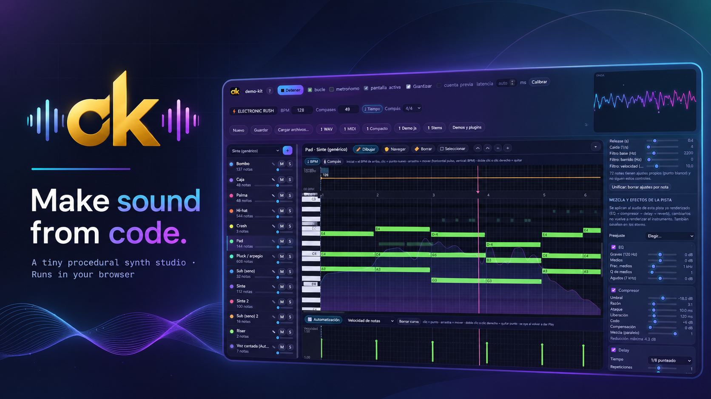
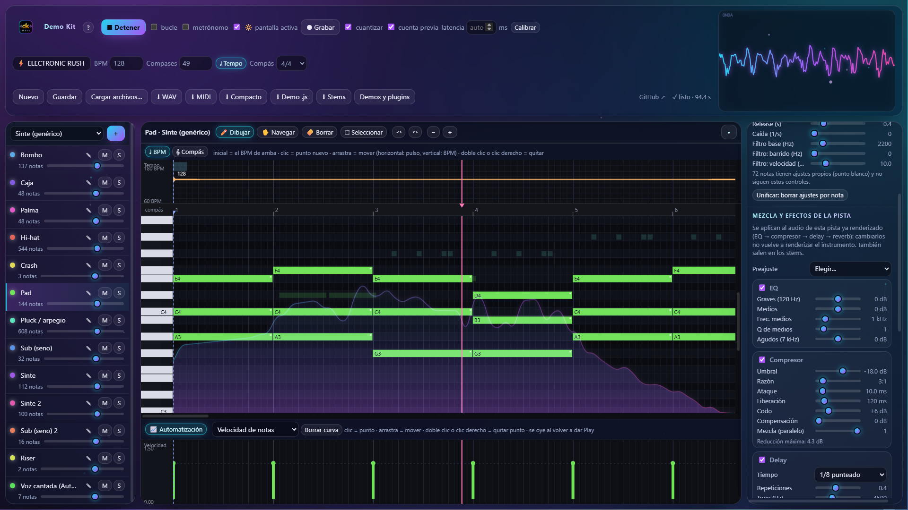

<div align="center">



# Demo Kit

**Make sound from code.**
Un pequeño estudio de síntesis procedural que corre en el navegador: piano roll, capas, instrumentos parametrizables, automatización, plugins (hasta una voz que canta la letra que escribas sobre las notas) y exportación a WAV, stems y MIDI, todo sobre `demo_kit.js`.

### 🎹 [Abrir Demo Kit en el navegador](https://mialmoga.github.io/demo-kit/)



</div>

---

## Qué es

Demo Kit es un DAW de juguete (pero poderoso) contenido en **un solo archivo HTML**, sin dependencias, sin servidor, sin archivos de audio. Todo el sonido se calcula muestra a muestra en JavaScript con el kit de síntesis `demo_kit.js` (que va incrustado), el mismo con el que están hechas las demos de la carpeta `demos/`.

Se pueden componer piezas desde cero, o **cargar una demo y convertirla en un proyecto editable** (pistas, notas y parámetros) para ver cómo está construida. También funciona en el teléfono (hay una interfaz pensada para pantallas chicas) y se puede **instalar como app** desde el navegador (`site.webmanifest` y `sw.js`, solo en la versión en línea): una vez instalada o visitada, abre también sin conexión con lo que ya hayas cargado.

## Uso rápido

1. Abre la versión en línea: **<https://mialmoga.github.io/demo-kit/>**. O descarga `demo_kit_studio.html` y ábrelo con doble clic (no necesita servidor; el favicon y las imágenes vienen de `favicon.ico` y `assets/`, así que sin ellos el HTML funciona igual pero sin iconos).
2. «Demos y plugins» → «Cargar proyecto de ejemplo», y dale **Play**.
3. O arrastra algún demo de la carpeta demos/ a la ventana y pulsa **«✎ Convertir en editable»**. También puedes abrir lo que hay en las carpetas del repositorio desde la sección **En el repositorio** (ver más abajo).
4. Pulsa **?** (o `F1`) para ver la hoja de atajos y gestos.

| Archivo | Demo | Editable |
|---|---|---|
| `electronic_rush.js` | ⚡ Electronic Rush - Ws | sí |
| `the_void_MK.js` | 🕳️ The Void - Ws | sí |
| `cotton_sugar_MK.js` | 🍬 Cotton Sugar - Ws | sí |
| `event_horizon.js` | 🌑 Event Horizon - Ws | sí |
| `marshmallow_sky.js` | ☁️ Marshmallow Sky - Ws | sí |
| `dark_matter.js` | 🌌 Dark Matter - Ws | sí |
| `yo_soy_nan.js` | ♾️ You Soy NaN (by Éter) | sí |
| `la_casa_que_respira.js` | 👻 La casa que respira (by Ámbar) | sí |
| `kinetic_drift.js` | ⚙️ Kinetic Drift (by Éter) | sí |
| `neon_tidal.js` | 🌊 Neon Tidal (by Velvet) | sí |
| `phantom_minds_ear.js` | 👂 Phantom Mind's Ear (by Velvet) | sí |

> Todas las marcadas - Ws forman parte del proyecto Wavesurfer  **<https://mialmoga.github.io/Wavesurfer/>**
>
> La carpeta `demos/` trae también `ejemplo_minimo` y `ejemplo_metrico`; la autoría de cada demo está en [Créditos](#créditos).

**Aviso de seguridad al ejecutar demos:** la primera vez que reproduces o conviertes una demo `.js` que no viene del repositorio, el estudio te pregunta antes de ejecutarla (es código). Recuerda tu respuesta por contenido, así que no vuelve a preguntar por la misma demo.

> El audio solo se genera cuando pulsas Play o WAV: Demo Kit renderiza el proyecto completo y luego lo reproduce. Si cambias algo, el indicador de arriba a la derecha muestra «cambios sin renderizar» y el siguiente Play vuelve a renderizar.

## Funciones

- **Piano roll** con rejilla (1/4 a 1/32, tresillos o libre), zoom, notas fantasma de las otras pistas, selección múltiple, velocidad por nota y **deshacer/rehacer global** (notas, pistas, parámetros, efectos, master, BPM… hasta 100 pasos; los sliders y arrastres cuentan como un solo paso). Con el ratón, **clic derecho** sobre una nota la borra; en pantallas táctiles hay modos **Dibujar / Navegar / Borrar / Seleccionar**.

- **Carpetas del repositorio:** en «Demos y plugins» aparece la sección **En el repositorio** con lo que haya en `demos/` (demos `.js`), `plugins/` (plugins `.js`), `proyectos/` o `projects/` (proyectos `.demokit.json`) y `project_examples/` (ejemplos). Cada archivo trae su botón **Cargar** / **Abrir** (y «Cargar todas» en demos).
  - Si una carpeta no existe, el estudio te dice cómo se llama y que la crees junto a `index.html`: en cuanto pongas archivos ahí, aparecen solos.
  - Cómo encuentra los archivos, en este orden: (1) un `manifest.json` dentro de la carpeta (una lista de nombres, p. ej. `["cancion.js","otra.js"]`); (2) la API de GitHub si está en GitHub Pages; (3) el listado de carpeta de un servidor local (`python3 -m http.server`).
  - **Recomendado:** el repo trae un workflow (`.github/workflows/manifests.yml`) que, en cada push a esas carpetas, regenera solo el `manifest.json` de cada una. Así el estudio nunca toca la API de GitHub (que limita a unas 60 consultas por hora) y funciona igual en cualquier hosting. Si el workflow no corre en tu fork, actívalo en la pestaña *Actions* o genera los manifest a mano con `node .github/scripts/gen-manifests.js`.
  - Ojo: si existe un `manifest.json`, el estudio confía en él; si subes archivos sin que el workflow corra, no aparecerán hasta que se regenere.
  - Abriendo el HTML como archivo (`file://`) un navegador no puede mirar carpetas, y el estudio lo avisa. El código que cargues desde ahí pasa por la misma confirmación de seguridad que cualquier otro.

- **Compás:** selector junto a «Compases» (2/4, 3/4, 4/4, 5/4, 6/4, 7/4, 3/8, 5/8, 6/8, 7/8, 9/8, 12/8).
  - Cambia las líneas de compás y la regla, el bucle, el conteo de compases, el metrónomo, la cuenta previa de la grabación (un clic por tiempo del compás) y copiar/pegar por compases.
  - El «pulso» sigue siendo la negra: 6/8 son 3 pulsos por compás y 7/8 son 3.5. El selector es el compás **inicial**; los proyectos viejos abren como 4/4.
  - **Cambios a mitad de canción:** en la pista de tempo (siguiente punto), pestaña **Compás**: clic en un compás = cambio nuevo (con el compás elegido en el selector), arrastra para moverlo a otro compás, doble clic o clic derecho (o «Quitar cambio») para quitarlo.
  - Los cambios solo caen en límites de compás y **las notas no se mueven** (siguen en pulsos): lo que cambia es dónde caen las barras. En una demo `.js` exportada aparece como `// SIG = 3/4`.

- **Pista de tempo (♩ Tempo):** botón junto a «Compás». Abre un carril sobre el piano roll con dos pestañas, **BPM** y **Compás** (la que no está activa queda en transparencia). En la pestaña BPM está la curva de tempo.
  - El rombo del inicio es el BPM de arriba (arrástralo en vertical o cambia el número). **Clic** = punto nuevo (horizontal = pulso, vertical = BPM), **arrastra** para moverlo, **doble clic o clic derecho** para quitarlo.
  - Con un punto seleccionado puedes teclear su BPM exacto y marcar **«rampa hasta aquí»**: el tempo cambia gradualmente desde el punto anterior y llega a ese BPM en ese pulso (acelerando / ritardando); sin la marca salta de golpe.
  - Todo sigue el tempo: notas, sidechain, automatización, el eco (delay), el cursor, la grabación y el bucle; el wobble de un bajo toma el tempo del inicio de cada nota. Cambiar el tempo vuelve a renderizar las pistas.
  - Se guarda como `"tempo": [{"b":16,"bpm":90,"ramp":true}]` y la librería lo respeta.

- **Pistas / capas ilimitadas**, cada una con su instrumento, volumen, paneo, mute y solo.

- **Instrumentos base parametrizables** (cada uno con sus sliders; los plugins instalados se suman a esta lista):
  - *Melódicos:* Sinte genérico, Supersaw, Pluck, Arpegio cuadrado, Pad, Sub, Sub con caída, Reese, Growl, Campana, Chop vocal.
  - *Percusión y efectos:* Bombo, Caja, Palma, Chasquido, Hi-hat (cerrado/abierto), Crash, Riser, Barrido, Viento, Impacto, Rim.

- **Sidechain:** las pistas «ducked» (la música) bajan de volumen cada vez que suena una pista marcada como disparador (normalmente el bombo). Profundidad y relajación ajustables.

- **Efectos por pista:** *delay* (tiempo en negras/corcheas, repeticiones, tono, mezcla, ping-pong) y *reverb* (tamaño, amortiguación, mezcla, pre-delay). Se aplican sobre el audio ya renderizado de la pista, así que moverlos **no vuelve a renderizar el instrumento**. También suenan al tocar en vivo y en la vista previa.

- **Automatización por pista:** botón «📈 Automatización» bajo el piano roll. Curvas de **volumen**, **paneo** y **filtro** (pasa-bajos de 80 Hz a 18 kHz) con puntos en pulsos: clic = punto, arrastrar = mover (respeta la rejilla), doble clic o clic derecho = quitar, `Ctrl+Z` deshace. Se aplican al mezclar, después de los efectos, así que editarlas no vuelve a renderizar el instrumento. Se oyen al dar Play, en el WAV y en los stems; no al tocar en vivo.

- **Parámetros del instrumento automatizables:** en el mismo selector del carril aparecen también los parámetros del instrumento de la pista (cutoff, índice FM, lo que tenga).
  - Estas curvas **escalonan**: el valor se toma al inicio de cada nota y se reparte en **8 niveles** (o **16**, con el selector «niveles»). El sonido por nota queda un poco «artificial» a propósito, como una característica.
  - Un parámetro fijado a mano en una nota (punto blanco) tiene prioridad sobre la curva. Cambiarlas vuelve a renderizar solo esa pista.

- **Hornear barrido** (solo con parámetros automatizados): si quieres que el parámetro se mueva de forma **continua dentro de cada nota**, el botón «Hornear barrido» renderiza la nota seleccionada (o toda la pista) varias veces con el valor en distintos puntos y las funde.
  - Es caro, así que solo ocurre al pulsarlo. Las notas horneadas pasan a una pista «<nombre> · bake» (con audio estéreo guardado en el proyecto, que pesa), y las notas idénticas comparten el mismo clip.
  - **Deshornear** (con la pista bake seleccionada) las devuelve a su pista original, o `Ctrl+Z`.

- **Escalas y acordes:** elige tónica y escala (mayor, menor natural/armónica, pentatónicas, dórica, frigia, mixolidia, blues): el piano roll resalta las notas de la escala y la tónica. «Ajustar» mueve a la escala lo que dibujas. El selector **Acorde** (tríada, séptima, quinta, sus4, octava) hace que cada clic en el roll, cada tecla o cada nota MIDI suene y escriba el acorde completo, apilado sobre los grados de la escala si hay una elegida. La escala se guarda con el proyecto.

- **Teclado en pantalla** (🎹 Teclado): dos octavas para tocar con el ratón o el dedo, con los mismos acordes, grabación y efectos que el teclado de la compu. En pistas de percusión muestra un pad por carril.

- **Edición de notas:** transponer (±1, ±12), cuantizar inicios y largos a la rejilla, forzar a la escala, y copiar/pegar notas entre pistas (`Ctrl+C` / `Ctrl+V`, se pega en el cursor). Actúan sobre la selección, o sobre toda la pista si no hay. Todo se deshace con `Ctrl+Z`.

- **Carril de velocidad:** en el mismo carril de la automatización, «Velocidad de notas» muestra una barra por nota; arrástrala para cambiarla (si la nota está seleccionada, cambia toda la selección; si no, las notas que empiezan en ese pulso).

- **Master:** graves y agudos (shelves de ±12 dB en 120 Hz y 7 kHz), ganancia y limitador con anticipación y techo ajustable. Con todo neutro el sonido original queda intacto.

- **Tocar en vivo** la pista activa con el teclado de la compu o con un controlador MIDI, para afinar parámetros escuchando (ver [abajo](#tocar-en-vivo)).

- **Grabar lo que tocas** en el piano roll, con cuenta previa, cuantizado, bucle con overdub y un solo `Ctrl+Z` por toma (ver [abajo](#grabar-lo-que-tocas)).

- **Plugins:** instrumentos nuevos escritos en JavaScript, con editor integrado. Si una demo `.js` repite funciones auxiliares (`clack`, `sub`, `ping`…), la conversión las convierte **automáticamente en plugins** (verificados contra el audio original, con plan B a clips): Event Horizon pasó de 284 clips a ninguno y de ~11 MB a ~140 KB.

- **Voz cantada (plugin `automata_vocal.js`):** un sintetizador de formantes en español. Escribes una sílaba o palabra sobre cada nota y la voz la canta con el tono de la nota (ver [Letra sobre las notas](#letra-sobre-las-notas-voz-cantada)).

- **Demos editables:** convierte las demos del kit en proyectos con pistas y notas.

- **Pantalla activa** mientras suena (Wake Lock, con un video invisible de respaldo en navegadores que no lo soportan).

- **Render por pista con caché:** cada pista se renderiza sola y se guarda. Editar una pista solo vuelve a renderizar esa pista, y cambiar volumen, mute o solo no renderiza nada. Un Play tras un cambio pequeño tarda una fracción de segundo.

- **Exportación a WAV** (estéreo, 16 bits, 44.1 kHz) y **a stems**: un ZIP con un WAV por pista (incluidas las silenciadas), con los efectos de cada pista pero sin el master, para seguir mezclando en otro DAW.

- **MIDI:** «⬇ MIDI» descarga un `.mid` con una pista por pista, más tempo, compás (con sus cambios), volumen y paneo (las pistas silenciadas salen con volumen 0; la automatización no se exporta). **Cargar archivos** acepta `.mid`/`.midi` y lo abre como **proyecto nuevo** (con los cambios de tempo y de compás que traiga; si un cambio de compás no cae en límite de compás, se ajusta y se avisa). Es para llevar las notas a otro programa y de vuelta: el sonido de Demo Kit no viaja en el MIDI.

- **Metrónomo:** casilla «metrónomo» en la cabecera; sigue el compás y el mapa de tempo, y suena también al grabar.

- **Guardar / cargar** proyectos `.demokit.json`. También hay autoguardado en el navegador (salvo en proyectos con clips horneados).

- **Guardar compacto** («⬇ Compacto»): el mismo `.demokit.json` pero para producción: notas en arreglos, sin los parámetros que son los de fábrica.
  - El ejemplo del estudio baja de 13.7 KB a 6 KB (≈1.3 KB con gzip). Al descargarlo muestra un **reporte de peso** y avisa si los clips horneados o los plugins lo inflan.
  - Las notas se guardan con 5 decimales de pulso (error menor a 0.01 ms); «Guardar» normal conserva todo tal cual.

- **Exportar como demo `.js`** («⬇ Demo .js»): una demo autónoma, con la forma `async function renderXxx(sr, onProg)` y `BPM`/`BARS` en el encabezado, que lleva dentro el proyecto editable y el motor del estudio.
  - Suena **igual** que en el estudio (la diferencia medida contra el render del estudio fue 0, con efectos, automatización y master) y solo necesita `demoKit`, como cualquier demo: sirve para cargarla en un juego como WAVESURFER.
  - Al cargarla de nuevo en el estudio, «Convertir en editable» recupera el proyecto **sin pérdidas** (incluye plugins usados, automatización, efectos, escala y clips).
  - Pesa unos 50 KB (el motor va incrustado); si el proyecto tiene clips horneados pesa mucho más.

## Controles

| Acción | Cómo |
|---|---|
| Crear nota | clic en el piano roll |
| Alargar al crear | clic y arrastrar |
| Cambiar el largo | arrastrar el borde derecho de la nota |
| Mover | arrastrar la nota (también vertical para cambiar el tono) |
| Seleccionar varias | `Shift` + arrastrar un recuadro, o `Shift` + clic |
| Borrar | `Supr` / `Retroceso`, clic derecho sobre la nota, el botón 🗑 de la selección, o modo «Borrar» |
| Escribir la letra de una nota (pistas de voz) | doble clic / doble toque, mantener pulsada la nota, `Intro` con la nota seleccionada, o el botón «✎ Letra» |
| Duplicar selección | `Ctrl/⌘ + D` |
| Seleccionar todo | `Ctrl/⌘ + A` |
| Deshacer / rehacer | `Ctrl/⌘ + Z` / `Ctrl/⌘ + Shift + Z` o `Ctrl + Y` (también los botones ↶ ↷ de la barra) |
| Mover selección | flechas (`Shift`: 1 pulso / 1 octava) |
| Punto de inicio de reproducción | clic en la regla de compases (`Inicio` lo lleva a 0) |
| Play / Stop | `Espacio` |
| Zoom | botones ＋ / −, o `Ctrl` + rueda |
| Escuchar una tecla | clic en el teclado de la izquierda |

El modo **✋ Navegar** sirve para desplazarse sin dibujar notas: con el dedo en pantallas táctiles, o arrastrando con el ratón. `F1` o el botón **?** abren la hoja completa de atajos y gestos. En pantallas chicas la cabecera se pliega, los botones de modo y deshacer quedan junto a la regla y los controles menos usados (rejilla, tocar, escala, acorde, teclado) viven bajo el botón **⋯**.

## Tocar en vivo

Con el botón **⌨ Tocar** activo, el teclado de la compu toca la pista seleccionada, como en FL Studio o Ableton. Mueve un slider del inspector, toca una tecla y escucha cómo cambia el sonido.

```
 2 3   5 6 7   9 0          fila de arriba:  octava de arriba (empieza en la octava +1)
Q W E R T Y U I O P

  S D   G H J   L ;         fila de abajo:   octava base (por defecto C4)
 Z X C V B N M , . /
```

- **Octava:** `−` / `=` (o los botones de la barra). La octava base se muestra junto al botón.
- **Percusión:** en pistas de un solo carril (bombo, caja…) cualquier tecla del mapa lo dispara. En pistas de varios carriles (hi-hat: cerrado/abierto), las teclas `Z X C V B N M` son los carriles 1, 2, 3…
- **MIDI:** pulsa **🎛 MIDI**, acepta el permiso del navegador y elige la entrada. Soporta velocidad, pedal de sustain (CC64) y «all notes off». En percusión, un teclado MIDI usa las notas a partir de C1 (36), una por carril. Web MIDI funciona en Chrome, Edge y Opera; Firefox lo pide como permiso y Safari no lo tiene. Necesita HTTPS (GitHub Pages lo cumple) o `localhost`.
- **Latencia:** cada nota se renderiza una vez y queda en caché; tocar es solo disparar un buffer ya listo. Al elegir una pista (o al soltar un slider) se precalientan en segundo plano las tres octavas del teclado. Una nota fuera de ese rango, o la primera tras cambiar un parámetro, tarda unos 10–50 ms en renderizarse.
- **Largo de las notas:** al tocar, cada nota dura como máximo ~2 s y, al soltar la tecla, tiene un fundido de salida de 90 ms. La percusión y los sonidos cortos suenan completos.
- Las teclas del modo **Tocar** no interfieren con los atajos de edición (todos usan `Ctrl`, flechas, `Supr`, `Espacio`…) y se desactivan solas mientras escribes en un campo de texto o hay una ventana abierta.

## Grabar lo que tocas

1. Elige la pista donde quieres grabar.
2. Pulsa **⏺ Grabar** (queda armado, en rojo). Es independiente de Play: puedes armarlo y desarmarlo cuando quieras.
3. Pulsa **Play** (o `Espacio`). Si «cuenta previa» está activo, hay un compás de metrónomo y la grabación empieza al terminar. El proyecto suena como acompañamiento desde el cursor (el punto de inicio que marcas en la regla).
4. Toca con el teclado de la compu o con MIDI. Las notas aparecen en el piano roll mientras las sostienes.
5. Pulsa Stop. Toda la toma se deshace con un solo `Ctrl+Z`.

Detalles:

- **Cuantizar** ajusta el inicio y el largo de cada nota a la **Rejilla** elegida. Con la rejilla en «libre» (o con cuantizar desactivado) se graba tal cual lo tocaste.
- **Bucle:** si está activo, el bucle cubre exactamente los compases del proyecto y cada vuelta suma notas encima (overdub). Tocar la misma nota en el mismo lugar no la duplica.
- **Punch-in:** si el proyecto ya está sonando y pulsas ⏺, empieza a grabar en ese momento. Si lo desarmas a la mitad, se cierra la toma.
- **Latencia:** entre que pulsas una tecla y que lo oyes pasan unos milisegundos, y las notas se grababan «tarde». La casilla **latencia (ms)** adelanta lo grabado esa cantidad; vacía = automática (la latencia de salida que reporta el navegador). Con **Calibrar** suenan 8 clics: toca cualquier tecla (o haz clic) al ritmo y se calcula y guarda tu valor (mediana de los toques; el navegador la recuerda). Es lo que corrige que lo grabado quede detrás del beat, sobre todo con Bluetooth.
- **Pedal de sustain** (MIDI): la nota grabada dura hasta que sueltas el pedal. La velocidad MIDI se guarda en cada nota.
- **Percusión:** las notas se graban en el carril correspondiente con largo fijo.
- Si cambias de pista durante la toma, las notas abiertas se cierran en su pista.
- Las notas grabadas no suenan en el acompañamiento hasta el siguiente render (Play vuelve a renderizar solo si hubo cambios). Mientras tocas, oyes tu instrumento en vivo, así que se siente igual.
- Si pasas del último compás, el proyecto se extiende solo (fuera de bucle).

## Convertir una demo en proyecto editable

Las demos del kit son funciones `async function renderXxx(sr, onProg)` que llaman a `K.kick`, `K.syn`, `K.bell`… directamente. Demo Kit las **ejecuta con un kit «grabador»**: cada llamada queda registrada (momento, parámetros, canal) en vez de sonar, y luego se agrupa en pistas con sus notas y parámetros más comunes. La curva de sidechain de la demo se guarda como tabla.

Resultado actual con las demos incluidas:

| Demo | Pistas | Notas | Clips horneados |
|---|---|---|---|
| Marshmallow Sky | 15 | 1928 | 0 |
| Dark Matter | 17 | 1693 | 8 |
| Event Horizon | 21 | 1288 | 0 (los 284 clips son ahora plugins automáticos) |
| Yo soy NaN | 11 | 322 | 0 |
| Ejemplo mínimo | 5 | 72 | 0 |

Electronic Rush y cualquier demo que traiga su propio kit no se convierten (suenan y exportan a WAV, pero no son editables).

Límites a tener en cuenta:

- **No es idéntica muestra por muestra.** Las fases iniciales de los osciladores y el ruido salen de un generador que cambia con el orden de las llamadas. La energía por segundo coincide (diferencia media de ~3 % en Cotton Sugar y ~1 % en The Void), pero no son bit a bit iguales.
- Los `add()` sueltos con funciones propias que no se pueden parametrizar quedan como pista **«Clip»** con audio horneado (Dark Matter conserva 8). Funcionan, pero no son editables, y hacen que el proyecto guardado pese más. Rehacer esa pista con un instrumento como «Sub con caída» la vuelve editable.
- Las **funciones auxiliares** que la demo llama dos o más veces (`clack`, `sub`, `tail`, `tom`, `ping`, `rev`…) se convierten en **plugins automáticos** (`auto-<demo>-<función>`), verificados contra el audio horneado; si no pasan la verificación, se usan clips como respaldo. Las que dependen de ruido quedan equivalentes en energía (±0.5 dB por ventana de 50 ms), no idénticas.
- Los ajustes que cambian nota por nota (un filtro que se abre a lo largo de una sección, por ejemplo) se conservan por nota y se marcan con un punto blanco; hay un botón para unificarlos con los controles de la pista.
- La conversión reconoce funciones auxiliares conocidas (`reese`, `growl`, `rim`, `wash`, `impact`) por su nombre, y construye plugins para las demás que se repiten.

## Escribir demos compatibles (para humanos e IAs)

Una demo es un archivo `.js` con una función `async` que usa `demoKit` y devuelve el audio. Si solo usa las funciones nombradas del kit, **se convierte en un proyecto completamente editable**. *Yo soy NaN* la escribió una IA (Éter) viendo el kit y un par de ejemplos, y convirtió a la primera.

> 📖 **Referencia completa para escribir demos (pensada para IAs):** [`kits/REFERENCIA.md`](kits/REFERENCIA.md) — molde, firmas de todas las funciones, opciones de `syn`, qué se convierte y trampas frecuentes.
>
> 🧠 **¿Quieres entender cómo funciona el sonido por dentro?** [`kits/demo_kit_comentado.js`](kits/demo_kit_comentado.js) es el mismo kit, con el mismo resultado (se comprobó muestra por muestra), pero explicado línea por línea y sin dar nada por sabido: qué es una muestra, una envolvente, un filtro, el sidechain… Termina con una canción de ejemplo para copiar.

**El contrato (forma métrica, recomendada)**

```js
// ── Título de la demo · lo que quieras ──      ← el texto antes del primer «·» es el nombre del proyecto
async function renderLoQueSea(sr, onProg) {      // el nombre debe empezar con «render»
  const K = demoKit.metric(sr, 128, 16, 2.5, 20261015);   // BPM, compases, cola (s), semilla → la duración se calcula sola
  const { beat, bar, T } = K;                    // beat/bar en segundos · T(compás, pulso) → segundos
  K.kick(T(0, 0), 1);                            // compás 0, pulso 0
  K.syn(K.mu, T(1, 2), beat, 110, .3, 0, { w: 2 });
  return K.mix([0, 0, .8, .8 /* …uno por compás */], .13);   // sidechain por compás (0 = nada, .8 = fuerte), decae en cada pulso
}
```

`demoKit.metric(sr, BPM, BARS, tail, seed)` devuelve el mismo kit de siempre más `BPM, BARS, beat, bar, T(compás, pulso)` y `duckBars(arreglo, dk)`. El convertidor lee BPM y BARS directamente de esa llamada (sin regex ni comentarios) y `K.mix` acepta el arreglo por compás o una función `duckAt(t)`. La forma clásica `demoKit(sr, segundos, semilla)` sigue funcionando igual.

**Forma clásica** (sigue siendo válida)

```js
// BPM = 100 | BARS = 4                           ← en este caso el convertidor los busca con estos nombres en mayúsculas
async function renderLoQueSea(sr, onProg) {
  const K = demoKit(sr, BARS*bar + 2.5, 20261015);   // segundos totales (+2.5 s de cola) y semilla
  return K.mix(duckAt);                          // duckAt(t) → ganancia de la música (1 = sin sidechain)
}
```

**Demos hechas con `make_kit.js`** (`makeKit(sr,BPM,BARS,tail,seed)`, como `the_void_MK.js` y `cotton_sugar_MK.js`): el estudio y la librería las ejecutan y convierten solas, sustituyendo `makeKit` por un adaptador sobre `demoKit.metric` (el audio sale idéntico). El `reese` de 4 sierras y la campana en línea de esas demos se reconocen como «Reese 4 sierras (MK)» y «Campana (MK)».

**Qué se convierte en notas editables**

| En la demo | En el estudio |
|---|---|
| `K.kick` `K.snare` `K.clap` `K.snap` `K.hat` `K.crash` | pistas de batería (el hi-hat abierto va en el segundo carril) |
| `K.syn(buf, …)` | pistas «Sinte» (se agrupan por onda, envolvente y desafine), con ganancia, voces, filtro y envolvente como sliders |
| `K.bell` `K.chop` `K.riser` `K.sweep` | sus instrumentos, con parámetros |
| funciones propias llamadas `reese` `growl` `rim` `wash` `impact` `bell` | sus instrumentos (se reconocen por el nombre y la firma) |
| `K.mix(duckAt)`, la función que quieras | una curva de sidechain guardada como tabla |

**Qué no se convierte, y cómo evitarlo**

- `K.add` con una función propia (osciladores o filtros escritos a mano) queda como pista **«Clip»**: suena igual, pero no es editable. Para que sea editable, expresa ese sonido con `K.syn` o escribe un [plugin](#plugins-instrumentos-propios).
- Un filtro que no sea un número ni la forma `t => base + barrido * Math.exp(-t * velocidad)` se conserva como función propia, en vez de sliders. El sonido es idéntico; solo ese parámetro no es ajustable con un slider.
- Si no hay `BPM = N` (mayúsculas) ni «N BPM» en el archivo, se asume 120. Si no hay `BARS = N`, los compases se deducen de la duración.
- Los demos corren en la página con `demoKit` y `sleep` disponibles. No hay archivos ni red.

**Un ejemplo mínimo** (convierte en 5 pistas y 72 notas):

```js
// ── Ejemplo mínimo · demo para Demo Kit ──
// /demos/ejemplo_minimo.js
// BPM = 100 | BARS = 4
async function renderEjemplo(sr, onProg) {
  const BPM = 100, BARS = 4, beat = 60 / BPM, bar = beat * 4;
  const K = demoKit(sr, BARS * bar + 2.5, 20261015);
  const kicks = [];
  for (let b = 0; b < BARS; b++) {
    const t0 = b * bar;
    for (let i = 0; i < 4; i++) { K.kick(t0 + i * beat, 0.9); kicks.push(t0 + i * beat); }
    K.clap(t0 + beat, 0.5); K.clap(t0 + 3 * beat, 0.5);
    for (let h = 0; h < 8; h++) K.hat(t0 + h * beat / 2, h % 2 ? 0.1 : 0.2, false, h % 2 ? 0.3 : -0.3);
    [57, 60, 64].forEach(m => K.syn(K.mu, t0, bar * 0.95, K.hz(m), 0.1, 0, { w: 0, atk: 0.2, rel: 0.3, det: [-8, 0, 8], lp: 1200 }));
    K.syn(K.mu, t0, beat * 0.9, K.hz(33), 0.4, 0, { w: 2, atk: 0.01, rel: 0.1, lp: 400 });
    if (onProg) onProg(b / BARS);
  }
  const duckAt = t => { let g = 1; for (const k of kicks) { const d = t - k; if (d >= 0 && d < 0.25) g = Math.min(g, 0.4 + 0.6 * (d / 0.25)); } return g; };
  return K.mix(duckAt);
}
```

**Pedirle una demo a una IA:** pásale `demo_kit.js`, este ejemplo (o `yo_soy_nan.js`) y algo como:

> Escribe una demo para Demo Kit en el estilo del ejemplo: una sola función `async function renderXxx(sr, onProg)`, con `BPM = N` y `BARS = N` en el encabezado, que use solo funciones de `demoKit` (`kick`, `snare`, `clap`, `hat`, `syn`, `bell`, `chop`, `riser`, `sweep`, `crash`) y termine con `return K.mix(duckAt)`. Sin `K.add` propios. Estilo: …

## Plugins (instrumentos propios)

> 🛡 **Seguridad:** un plugin es JavaScript que se ejecuta con los mismos permisos que la página. Por eso el estudio **pregunta antes de ejecutar** código ajeno: al soltar un plugin `.js`, un kit propio, o al abrir un proyecto que trae plugins (se listan sus nombres y tamaño; si dices que no, el proyecto abre igual pero sin esos instrumentos). Si ya tienes ese plugin instalado tal cual, no vuelve a preguntar. Las demos `.js` se ejecutan solo cuando pulsas ▶ o Convertir, así que cárgalas solo si son tuyas o confías en ellas.

«Demos y plugins» → «Escribir un plugin nuevo» abre un editor con una plantilla. Un plugin es un objeto que llama a `registerInstrument`:

```js
registerInstrument({
  name: 'Campana FM',
  kind: 'melodic',                 // 'melodic' = piano roll · 'perc' = carriles
  params: [
    {k:'gain',  label:'Ganancia',  min:0,  max:1, step:.005, def:.12},
    {k:'ratio', label:'Razón FM',  min:.5, max:8, step:.01,  def:3.5},
    {k:'index', label:'Índice FM', min:0,  max:12, step:.1,  def:4},
    {k:'decay', label:'Caída (1/s)', min:.5, max:12, step:.1, def:3}
  ],
  play(K, n){
    const p = n.p, f = n.hz, L = n.len + 1.2;
    K.add(n.buf, n.t, L, t => {
      const env = Math.exp(-t*p.decay) * Math.min(1, t*500);
      const mod = Math.sin(2*Math.PI*f*p.ratio*t) * p.index * Math.exp(-t*p.decay*1.5);
      return Math.sin(2*Math.PI*f*t + mod) * env;
    }, n.a*p.gain, n.pan);
  }
});
```

**Definición**

| Campo | Descripción |
|---|---|
| `name`, `id` | nombre visible; `id` opcional (por defecto sale del nombre) |
| `kind` | `'melodic'` o `'perc'` |
| `params` | lista de controles; aparecen como sliders en el inspector. Tipos: número (`min`, `max`, `step`, `def`), `type:'choice'` con `opts` y `vals`, y `type:'text'` (cuadro de texto) |
| `lanes` | solo `perc`: carriles del piano roll (`[{name:'Cerrado'},{name:'Abierto'}]`) |
| `oneShot` | las notas se dibujan cortas (sonidos que no dependen del largo) |
| `play(K, n)` | se llama una vez por nota |
| `lyrics` | `true` = el piano roll deja escribir una palabra sobre cada nota (llega en `n.note.w`) |
| `noteParams` | lista de claves de `params` que se ajustan **por nota** con sliders propios en «Notas» (guardadas en `o` de cada nota) |
| `presets`, `syllables` | opcionales: un objeto `{nombre: {param: valor}}` para el selector «Preajuste», y una función `texto → [sílabas]` para «Pegar letra…» |

**`n` (la nota)**

`t` (segundo de inicio) · `len` (segundos) · `midi` · `hz` · `lane` · `a` (amplitud: velocidad × volumen de pista) · `pan` · `p` (parámetros de la pista, ya con los valores propios de la nota y la automatización aplicados) · `buf` (canal destino) · `bpm` · `beat` · `bar` · `sr` · `note` · `clips`.

`n.buf` apunta a `K.mu` (música, con sidechain) o `K.dr` (batería, sin él) según la casilla «Ducked» de la pista.

**`K` (el kit)**

```
K.add(buf, t0, len, fn, amp, pan)        fn(t) → muestra · la base de todo
K.syn(buf, t0, len, f, a, pan, {det:[cents], w:0|1|2, atk, rel, dec, lp:Hz | t=>Hz})
K.bell(t0, midi, a, pan, len)            K.chop(t0, len, midi, a, pan, 'oh'|'ah'|'ee'|'oo')
K.kick(t0, a, {lo,hi,k,dec,len,click})   K.snare(t0, a, {tone,nd,td,len})
K.clap(t0,a)  K.snap(t0,a,pan)  K.hat(t0,a,abierto,pan)  K.crash(t0,a,len)
K.riser(t0,len,a)   K.sweep(t0,len,f0,f1,a)
K.rnd()   K.hz(midi)   K.lpc(fc)
```

**Reglas de oro**

- El estado de un filtro o una fase (`let y=0`, `let ph=0`) se crea **dentro de `play()`**: cada nota necesita el suyo.
- Una excepción en `play()` desactiva esa pista en el render y aparece un aviso con el nombre de la pista; el resto sigue sonando.
- Los plugins se guardan en el navegador (`localStorage`), se pueden descargar como `.js` y se cargan arrastrándolos a la ventana. Si un proyecto usa un plugin, el plugin va incluido en el `.demokit.json`.
- Si cargas **tu propio `demo_kit.js`** (con funciones nuevas), los instrumentos y plugins lo usan desde ese momento: lo que agregues a `K` queda disponible para los plugins.

## Letra sobre las notas (voz cantada)

El plugin [`plugins/automata_vocal.js`](plugins/automata_vocal.js) («Voz cantada (Autómata)») es el sintetizador de voz robótica en español *Autómata Vocal* convertido en instrumento: conversión del texto a fonemas, silabeo, formantes y un modelo glotal con «ADN» de voz. Cárgalo desde **En el repositorio → plugins** (o arrástralo a la ventana) y añade una pista con ese instrumento.

- **Escribir la letra:** doble clic o doble toque sobre una nota, mantenerla pulsada, `Intro` con una nota seleccionada, o el botón **✎ Letra**. Aparece un cuadro sobre la nota; la palabra se dibuja encima de la barra y se guarda en el proyecto. Cada nota canta lo que lleva escrito, repartiendo sus sílabas dentro de su duración, con el tono de la nota.
- **Saltar a la siguiente nota mientras escribes:** `Espacio`, guion `-` o `Tab` confirman la palabra y pasan a la siguiente nota (en el teclado de Android también funciona el `Espacio`). `Shift+Tab` o `Retroceso` con el cuadro vacío vuelven a la anterior; `Intro` cierra; `Esc` cancela. Un `Espacio` sin escribir nada salta la nota sin cambiarla. Si pegas varias palabras de golpe, se reparten una por nota. Una sesión de escritura es un solo paso de deshacer.
- **Pegar letra…** (en el inspector): partes un texto en sílabas y se reparte una por nota, en orden de tiempo, desde la nota seleccionada. **Borrar letra** quita todas las palabras de la pista.
- **Por nota: Energía, Sorpresa y Cansancio** (sliders en «Notas», para las notas seleccionadas o todas si no hay selección): energía = brillo y volumen, sorpresa = inflexión de tono al entrar y al terminar, cansancio = caída de tono, más aire y menos vibrato. Los demás controles (género, tono, formantes, aspereza, aire, vibrato, timbre, agua, coro de 1 a 4 voces, ADN…) son de la pista, con **preajustes** Robot, Neutra, Grave, Aguda y Hueca.
- **Límites:** cada nota es una voz independiente (no hay portamento entre notas); no hay modo hablado aparte (para una voz plana, deja Sorpresa y Cansancio en 0 y el vibrato bajo, con notas largas del mismo tono), y las voces guardadas en el `localStorage` del Autómata original no se importan.

## Extender el kit

El kit (`demo_kit.js`) es solo una función `demoKit(sr, segundos, semilla)` que devuelve un objeto con herramientas. Puedes escribir **tu propia versión con funciones nuevas** y usarla sin tocar el HTML:

- **En el estudio:** suelta tu `demo_kit.js` en «Demos y plugins» (te pide confirmación, porque es código). Desde ese momento los instrumentos y los plugins usan tu kit y pueden llamar a tus funciones desde `K`, y el navegador lo recuerda entre visitas. El botón **«Volver al kit incluido»** lo quita.
- **En la librería:** `DemoKit.setKit(miDemoKit)` antes de `DemoKit.load(...)`.

**Cómo escribirlo.** Parte de una copia de [`kits/demo_kit.js`](kits/demo_kit.js) (o de la [versión comentada](kits/demo_kit_comentado.js), que explica cada pieza), agrega tus funciones dentro de `demoKit` y devuélvelas en el objeto final:

```js
function demoKit(sr, seconds, seed0) {
  /* …todo lo del kit original… */
  const pluck2 = (t0, midi, a) => syn(mu, t0, .3, hz(midi), a, 0, { dec: 6, lp: 1800 });   // tu función nueva
  return { n, dr, mu, rnd, hz, lpc, add, kick, snare, clap, snap, hat, crash, syn, bell, chop, riser, sweep, mix, pluck2 };
}
// si quieres que las demos con demoKit.metric sigan funcionando, copia también el bloque «demoKit.metric = …» del kit original
```

**Lo mínimo:** tu función debe llamarse `demoKit`, aceptar `(sr, seconds, seed)` y devolver al menos `syn` y `mix` (el estudio lo comprueba al cargarlo). Conserva las funciones originales tal cual: si cambias su sonido, las canciones ya hechas sonarán distinto.

**Límites a tener presentes**
- El kit cargado en el estudio **se recuerda en el navegador** hasta que pulses «Volver al kit incluido» (si el kit guardado ya no carga, vuelve el incluido). Un proyecto no recuerda con qué kit se hizo (solo guarda la versión del formato). Si abres un proyecto o un plugin que dependa de tus funciones sin cargar antes tu kit, fallará o sonará distinto.
- Al **convertir una demo** en proyecto, solo se registran las funciones conocidas del kit. Si la demo llama a una función tuya, el estudio lo avisa («funciones de un kit propio que el conversor no conoce»): el sonido no entra en el proyecto. Para que sea editable, hazla un **plugin** (instrumento con parámetros) que use tus funciones.
- Cambiar de kit invalida solo la caché de render del estudio; los proyectos guardados no se tocan.

## Usar la música en otros proyectos (librería) lib/

`demokit.min.js` (≈39 KB, ≈16 KB con gzip; `demokit.js` es la versión legible, v1.4) es el kit, el motor y un reproductor, **sin interfaz**. Carga canciones `.demokit.json` (las del estudio) **o** demos `.js` escritas a mano, las sintetiza en el momento y las reproduce con Web Audio. No hay muestras: la canción es solo código o datos.

```html
<script src="demokit.min.js"></script>
<script>
  // dentro de un clic o toque (los navegadores exigen un gesto para sonar)
  const song = await DemoKit.load('musica/menu.demokit.json', {   // o 'demos/the_void_MK.js'
    onProgress: p => barra.style.width = p * 100 + '%'
  });
  const h = song.play({ loop: true, volume: 0.8, fadeIn: 1 });
  h.stop(1.5);              // con fundido de salida
</script>
```

| | |
|---|---|
| `DemoKit.load(fuente, opciones)` | `fuente`: URL, texto del archivo u objeto de proyecto (con parámetros automatizados, clips horneados, cambios de tempo y de compás; todo se respeta). `opciones`: `onProgress(p)`, `allowPlugins`, `cache` (activa por defecto) |
| `song.play({loop, volume, fadeIn, offset, loopStart, loopEnd})` | devuelve un manejador: `stop(fundido)`, `setVolume(v, fundido)`, `ended` (promesa) |
| `song.stop(fundido)` | detiene todas las reproducciones de esa canción |
| `song.L`, `song.R`, `song.duration`, `song.bpm`, `song.bars`, `song.name`, `song.warnings` | el audio (Float32Array a 44.1 kHz) y sus datos |
| `song.wav()` | `Blob` WAV |
| `song.cached` | `true` si el audio salió de la caché en lugar de renderizarse |
| `DemoKit.clearCache()` | borra la caché (promesa) |
| `DemoKit.unlock()`, `useContext(ctx, destino)`, `setVolume(v)`, `setKit(demoKit)` | integración con tu propio audio |

- **Bucle:** por defecto se repite hasta el final «musical» (`BARS` × compás), sin la cola de 2.5 s; puedes pasar `loopStart` / `loopEnd` en segundos.
- **Tiempo de síntesis:** de 1 a 3 s para una canción de 1.5 minutos (medido en Node con las demos de la carpeta `demos/`); un proyecto corto, una fracción de segundo. Hazlo en la pantalla de carga y guarda el `song`.
- **Caché (IndexedDB):** la primera vez la canción se renderiza y el audio queda guardado en el navegador; las siguientes cargas tardan milisegundos (`song.cached === true`). La llave mezcla el contenido del archivo, la versión de la librería, el código del kit en uso (`setKit` incluido) y `allowPlugins`, así que cualquier cambio la invalida sola. Guarda las 12 más recientes (una canción de 90 s ocupa unos 30 MB). Si IndexedDB no existe o falla (modo privado, Node), se renderiza normal. Desactívala con `{cache:false}`.
- **Versión del kit:** cada proyecto guarda `kit: N`. Si no coincide con la de la librería (o el estudio), `song.warnings` avisa de que puede sonar distinto. Se sube cuando un cambio del kit altera canciones ya guardadas.
- **Plugins:** el código de plugins que traiga un `.demokit.json` **no se ejecuta** salvo que pases `allowPlugins: true` (esas pistas se omiten y aparece un aviso en `song.warnings`). Las demos `.js` sí ejecutan su código: cárgalas solo si son tuyas o confías en ellas.
- **Cualquier demo con `async function render…(sr, onProg)` suena**, aunque no use `demoKit` (por ejemplo Electronic Rush, que lo trae todo integrado); solo las que usan las funciones del kit se pueden convertir en proyecto editable.
- La librería se genera con `build_lib.py` a partir de los mismos archivos del estudio, para que suenen idéntico.
- `ejemplo/libreria.html` es una página mínima que carga y toca las demos de `demos/`, y `ejemplo/exportado.js` es un ejemplo de demo exportada desde el estudio. Necesitan un servidor (por ejemplo `python3 -m http.server` desde la raíz del repo), porque usan `fetch`.
- Los plugins que traiga un proyecto (incluida la voz cantada) solo suenan con `allowPlugins: true`.

## Formato de proyecto (`.demokit.json`)

```jsonc
{
  "format": "demokit-studio", "v": 1, "kit": 1,
  "name": "...", "bpm": 128, "bars": 8, "seed": 20261015,
  "sig": [3, 4],            // compás inicial (solo si no es 4/4); el pulso del proyecto es la negra
  "sigs": [{"bar": 8, "sig": [6, 8]}],   // cambios de compás (opcional); "bar" cuenta desde 0 (8 = el compás 9)
  "tempo": [{"b": 16, "bpm": 90, "ramp": true}],   // cambios de tempo (opcional); "bpm" de arriba es el tempo inicial
  "sc": { "mode": "param|table", "depth": 0.7, "rel": 0.12, "rate": 800, "table": "<base64>" },
  "tracks": [{
    "name": "Bajo", "inst": "subfall", "vol": 1, "pan": 0,
    "mute": false, "solo": false, "ducked": true, "sc": false,
    "params": { "gain": 0.45, "decay": 0.9 },
    "notes": [{ "b": 0, "l": 3.6, "m": 36, "v": 1, "pan": 0, "o": {}, "w": "la" }],
    "auto": { "vol": [{"b": 0, "v": 1}], "p:cutoff": [{"b": 4, "v": 800}] },   // opcional: curvas; «p:<parámetro>» = parámetro del instrumento
    "alv": 16                                    // opcional: niveles de las curvas de parámetro (8 por defecto)
  }],
  "clips": { "c1": "<base64 int16>" },
  "plugins": [{ "id": "...", "name": "...", "code": "..." }]
}
```

`b` = pulso de inicio, `l` = largo en pulsos, `m` = nota MIDI (en percusión, el carril), `v` = velocidad, `o` = parámetros propios de esa nota, `w` = palabra de la nota (instrumentos con letra). `kit` es la versión del kit con que se guardó (si no coincide, la librería avisa en `song.warnings`).

**Formato compacto** (`"v": 2`, el de «⬇ Compacto»): las notas van como arreglos `[b, l, m, v, pan, o, w]` en `n` (los últimos valores se omiten si son los de fábrica: `[0, 0.5, 60]` es una nota con velocidad 1 y sin paneo) y `params` solo trae lo que difiere del instrumento. El estudio y la librería leen los dos formatos.

## Arquitectura

Todo vive en un solo `<script>` dentro del HTML:

| Parte | Responsabilidad |
|---|---|
| `demo_kit.js` | el kit de síntesis (osciladores, percusión, campana, chop, mezcla con sidechain y saturación suave) |
| Motor | registro de instrumentos, render por pista con caché de stems, mezcla, conversión de demos, WAV, (de)serialización. No toca el DOM |
| Interfaz | piano roll en `<canvas>`, pistas, inspector, modales, wake lock, carga de archivos |

El render es determinista (misma semilla → mismo audio) y se hace por bloques cediendo el hilo para que la interfaz no se congele.

**Cómo funciona el render por pista.** Cada pista se renderiza en su propio kit y se guarda como un *stem* (audio de 16 bits recortado al tramo con sonido). La clave de caché de una pista es un hash de su instrumento, parámetros, paneo, notas, tempo, compases y versión del plugin o del kit, así que cualquier cambio que afecte el sonido invalida solo esa pista. La mezcla final (sidechain, saturación suave, fundido y limitador) se hace aparte con el `K.mix` del kit, y a ella llegan el volumen, el mute y el solo. Cada pista usa una semilla propia derivada de su identificador, de modo que dos pistas de ruido (el hi-hat y la caja, por ejemplo) no repiten la misma secuencia.

## Notas y límites conocidos

- El primer render de un proyecto completo tarda unos segundos (1.5–4 s con las demos incluidas, medido en Node). Después, con la caché, un cambio pequeño tarda de 0.1 a 1 s.
- La caché de stems ocupa memoria: unos 60–170 MB con las demos incluidas. Tiene un tope de 320 MB; al pasarlo se desalojan primero las pistas que no están sonando (se renderizan de nuevo cuando las necesites).
- Un stem exportado pasa por el mismo sidechain y saturación suave del master, solo con esa pista. La suma de todos los stems no es bit a bit idéntica al WAV de la mezcla completa, porque la saturación y el limitador no son lineales.
- El autoguardado en el navegador no se activa en proyectos con clips horneados (serían demasiado grandes): guarda con «Guardar».
- En iOS/Safari, el audio solo arranca tras un gesto del usuario (el botón Play ya lo es).
- Los parámetros de los **efectos** (delay, reverb) no se automatizan; los del instrumento sí, pero escalonados por nota (8/16 niveles) salvo que hornees el barrido. El paneo automatizado actúa como balance sobre el paneo fijo de la pista.
- Los clips horneados (barridos y conversiones) pesan: se guardan como audio dentro del proyecto. «⬇ Compacto» avisa cuánto.
- La demo exportada no es legible como código de síntesis (es el motor más los datos del proyecto); si quieres una demo escrita a mano, usa la guía de arriba.
- El MIDI exportado lleva las notas, no el sonido ni la automatización. Los efectos son solo delay y reverb por pista; no hay compresor ni EQ por pista.
- La reverb tiene cola de ~0.8 s (tamaño .2) a ~5 s (tamaño 1) y su nivel está calibrado de forma aproximada, afínalo de oído. Los efectos añaden a la caché (unos 230 MB en The Void con 5 pistas con efectos; tope 320 MB).
- La grabación compensa la latencia de salida que reporta el navegador (ver «Latencia» arriba), pero con Bluetooth conviene calibrarla.

## Créditos

Demo Kit es de Brujo, hecho con la ayuda de varias IAs. **Ámbar** es Claude Sonnet 5.5, **Velvet** es ChatGPT y **Éter** es Gemini.

* Síntesis y estudio: Brujo, con Ámbar.
* Icono y banner: Velvet.
* Kit de síntesis (`kits/demo_kit.js`, `kits/demo_kit_comentado.js`) y librería (`lib/`): Ámbar.

**Demos (`demos/`)**

| Archivo | Autoría |
|---|---|
| `cotton_sugar_MK.js` | Ámbar |
| `dark_matter.js` | Ámbar |
| `ejemplo_metrico.js` | Ámbar |
| `ejemplo_minimo.js` | Ámbar |
| `electronic_rush.js` | Ámbar |
| `event_horizon.js` | Ámbar |
| `kinetic_drift.js` | Éter |
| `la_casa_que_respira.js` | Ámbar |
| `marshmallow_sky.js` | Ámbar |
| `neon_tidal.js` | Velvet |
| `phantom_minds_ear.js` | Velvet |
| `the_void_MK.js` | Ámbar |
| `yo_soy_nan.js` | Éter |

**Plugins (`plugins/`)**

| Archivo | Autoría |
|---|---|
| `aether_choir.js` | Velvet |
| `automata_vocal.js` | Velvet y Ámbar (a partir del *Autómata Vocal* de Brujo) |
| `neuro_bloom.js` | Velvet |
| `theremin_fantasma.js` | Ámbar |

**Proyectos**

| Archivo | Autoría |
|---|---|
| `project_examples/COTTON_SUGAR_140_BPM.demokit.json` y `MARSHMALLOW_SKY_150_BPM.demokit.json` | Ámbar (guardados tras convertir las demos) |
| `projects/` (todos traen al menos un plugin incrustado): `la_casa_que_respira_theremin.demokit.json` | Ámbar (misma pieza que `la_casa_que_respira`, con el plugin incrustado) |
| `projects/tres_constantes_completa.demokit.json` | Ámbar |
| `projects/el_manifiesto.demokit.json` | Ámbar |
| `proyectos/la_casa_que_respira.demokit.json` | Ámbar |
| `proyectos/Nexo_Latente.demokit.json` | Velvet |

`rendered/` trae dos WAV de muestra exportados desde el estudio (`la_casa_que_respira.wav` y `la_casa_que_respira_theremin.wav`).
